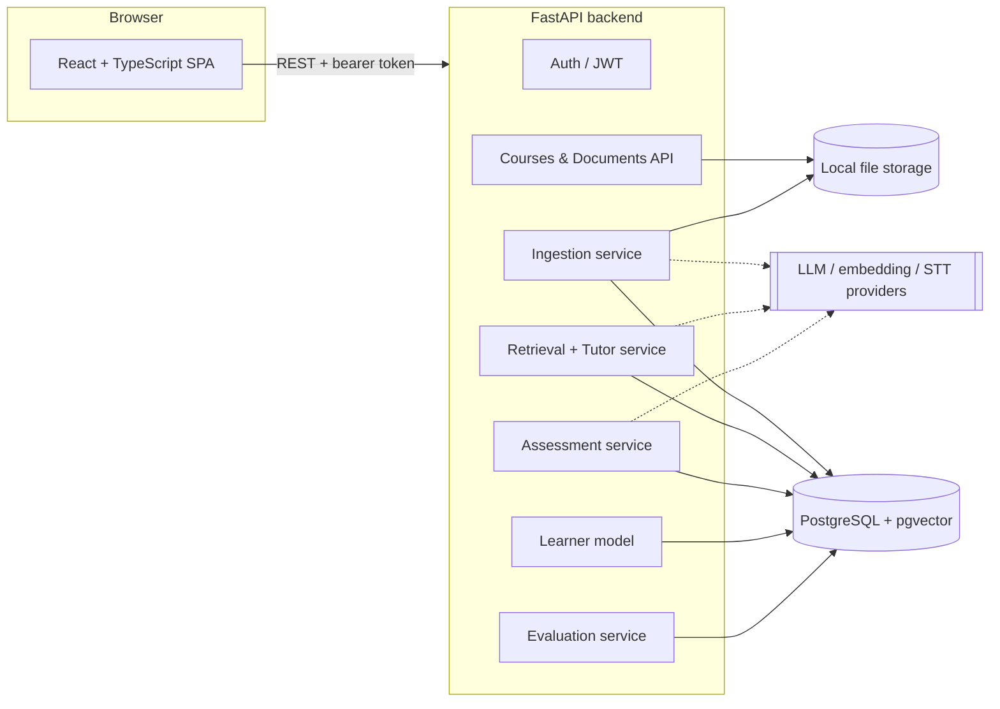

# NOVA Learn AI — Architecture (Stage 1 deliverable)

Status legend used throughout: **Built** = implemented and tested in this delivery (through Stage 4) · **Planned** = designed, not yet built.

## 1. System overview



Solid arrows exist today. Dashed arrows are optional AI providers: with none configured the system still runs (offline lexical embeddings, extractive tutor), Hosted providers are not claimed as live-verified here; adapter tests use mocked HTTP.

**One data store.** PostgreSQL holds relational data *and* vectors (pgvector, HNSW cosine index). No second vector database, so a course filter and a similarity search run in one SQL query and course isolation is enforced in one place.

## 2. Component responsibilities

| Component | Responsibility | Status |
|---|---|---|
| `frontend/` | SPA: auth, onboarding, dashboard, courses, uploads, settings | Built |
| `api/` | HTTP layer only: validation, authN/authZ, no business logic | Built |
| `services/ingestion/` | Upload validation, inspection, extraction (PDF/PPTX/image/transcript/video), OCR, embedded-figure extraction, chunking, embedding, indexing, job runner | Built; live vision unverified |
| `services/retrieval/` | Hybrid (pgvector + full-text, RRF fusion) retrieval scoped to a course; evidence-sufficiency check; citation records. No separate reranker | Built |
| `services/tutoring/` | Grounded answers, server-side citation validation, unsupported-question refusal, prompt-injection fencing, extractive fallback | Built |
| `services/assessment/` | Offline cloze + LLM generation, verification gate, deterministic grading, duplicate prevention, orchestration, results/analytics | Built |
| `services/knowledge/` | Topic hierarchy (k-means heuristic or LLM, validated), user corrections, locks | Built |
| `services/providers/` | Swappable LLM / embedding / speech-to-text adapters | Built (mock-tested only) |
| `services/learner/` | BKT mastery updates (append-only history), rule-based recommendations, spaced repetition intervals | Built |
| `services/evaluation/` | Source-labeled retrieval checks + seeded simulations; optional RAGAS CLI | Partial; optional framework integration and simulation are not backed by a human-reviewed benchmark or live RAGAS run |

## 3. Data model (all tables exist in migration `0001`)

```
users ─┬─< courses ─┬─< documents ─< processing_jobs
       │            ├─< topics (self-ref parent_id) ─< topic_prerequisites (topic_id, prerequisite_id)
       │            ├─< content_chunks (document_id, topic_id, subtopic_id, embedding vector(768))
       │            └─< questions ─< question_sources >─ content_chunks
       ├─< conversations ─< conversation_messages (citations = chunk ids)
       ├─< assessments ─< assessment_questions >─ questions
       │      └─< assessment_attempts ─< student_answers
       ├─< topic_mastery_history (previous, new, correct, difficulty, attempt, question, evidence)
       ├─< revision_recommendations
       └─< evaluation_runs ─< evaluation_metrics (value NULL + available=false + reason when not computable)
```

Design decisions:

- **UUID primary keys**, `ON DELETE CASCADE` from user → course → document → chunk, so deleting a course or account removes derived data. Files on disk are removed by the API after the DB commit.
- **Provenance on every chunk.** `page_number`, `slide_number`, `start_seconds`, `end_seconds`, `figure_ref` are nullable; non-applicable fields stay `NULL`, never invented. `is_generated_description` flags vision-model output so it is never presented as quoted source text.
- **Prerequisites are a separate edge table**, not derived from embedding similarity. Similar ≠ prerequisite.
- **Mastery is an append-only event log** (`topic_mastery_history`); current mastery is the latest row per topic. This keeps every update auditable and lets the dashboard chart change over time from real rows.
- **Evaluation metrics can be unavailable**: `value` is nullable with `available` and `unavailable_reason`, so the UI can show "not computed" rather than a fabricated number.
- **Embedding dimension is fixed at migration time** (`EMBEDDING_DIM`, default 768). Changing embedding models to a different dimension needs a new migration and re-embedding.

## 4. API contract

All routes are under `/api`, JSON, bearer-token auth unless noted. Interactive docs: `http://localhost:8000/docs`.

| Method & path | Purpose | Status |
|---|---|---|
| `POST /auth/register`, `POST /auth/login` (rate-limited), `GET /auth/me` | Authentication | Built |
| `PATCH /users/me`, `GET /users/me/export`, `DELETE /users/me` | Profile, data export, account deletion | Built |
| `GET/POST /courses`, `GET/PATCH/DELETE /courses/{id}` | Course CRUD with status/source counts | Built |
| `GET/POST /courses/{id}/documents` | List / upload (multipart, validated) | Built |
| `GET /documents/{id}`, `DELETE`, `POST /retry`, `POST /replace` | Document lifecycle | Built |
| `GET /documents/{id}/file` | Authorised original-file access | Built |
| `GET /jobs/{id}` | Processing-job status | Built |
| `GET /dashboard` | Aggregates from real rows (mastery, weak topics, activity, recommendations) | Built |
| `GET/POST /courses/{id}/topics`, `PATCH/DELETE /topics/{id}`, prerequisites, `POST /courses/{id}/topics/rebuild`, `PATCH /chunks/{id}` | Topic tree and user corrections | Built |
| `GET /chunks/{id}`, `GET /documents/{id}/media-token`, `GET /media/documents/{id}[/pages/{n}.png][/figures/{ref}]`, `GET /documents/{id}/slides/{n}` | Source opening for citations (short-lived, document-scoped media tokens) | Built |
| `POST /courses/{id}/chat`, conversations, suggestions, `GET /system/capabilities` | Grounded tutor (non-streaming) | Built |
| `POST/GET /courses/{id}/assessments`, `GET /assessments/{id}`, `POST /assessments/{id}/attempts`, `POST /attempts/{id}/submit`, `GET /attempts/{id}`, `GET /courses/{id}/attempts` | Generate, take, submit, review (answers never exposed before submission) | Built |
| `GET /courses/{id}/analytics`, `/next-assessment`, `/recommendations`, `POST /recommendations/{id}/dismiss` | Learner model views | Built |
| `POST /courses/{id}/study-plan` | Generate an exam-date schedule from BKT estimates; Dashboard can export it as `.ics` | Built (fixed decay heuristic) |
| `GET /courses/{id}/revision-cards` | Verified, source-cited question cards from the student's weak topics | Built (reuses question bank) |
| `GET /courses/{id}/evaluation-sources` | Paginated, course-owned chunks for exact benchmark source labels | Built |
| `POST /courses/{id}/evaluations/retrieval`, `POST /courses/{id}/evaluations/personalization` | Run retrieval checks or isolated learner simulations | Built |
| `GET /courses/{id}/evaluations`, `GET /evaluations/{id}` | List and read evaluation runs | Built |

Errors use FastAPI's standard `{ "detail": "..." }` (strings for domain errors, a list for validation errors). Cross-user access always returns **404**, not 403, so IDs cannot be probed.

## 5. Ingestion pipeline

| # | Step | Status |
|---|---|---|
| 1 | Upload + validation (extension allow-list, magic-byte check, size cap, streaming write, UUID filename on disk) | Built |
| 2 | Job creation (`processing_jobs`), background execution, retry | Built |
| 3 | Structural inspection: PDF pages and text-layer/scan detection, PPTX slide count, image decode, `ffprobe` duration + audio check, transcript cue detection | Built |
| 4 | Text extraction with page/slide/timestamp provenance (PDF text layer, PPTX text + tables + notes, transcripts). **PDF table extraction not implemented** | Built |
| 5 | OCR for scanned PDF pages, images, embedded PDF figures and substantial slide pictures; optional AI-written vision descriptions (live vision unverified) | Built |
| 6 | FFmpeg audio extraction + speech-to-text with timestamps (local Whisper or OpenAI-compatible; **neither run against the real service here**). Video *frame* analysis not implemented | Built (STT adapters mock-tested) |
| 7 | Sentence-aware chunking that never crosses a page/slide boundary; time-window chunking for transcripts; embedding; pgvector indexing | Built |
| 8 | Topics: k-means heuristic (flat, no prerequisites) or LLM with validated subtopics/prerequisites (cycle-checked), serialised per course by an advisory lock | Built |
| 9 | Verification (stored chunks and vectors must equal extracted chunks) and `indexed` status | Built |

Job status values: `queued → processing → indexed | failed`, with live `stage` (inspecting, extracting, chunking, embedding, indexing, topics). Indexing is all-or-nothing: a failure leaves no partial chunks, and Retry is idempotent.

## 6. Retrieval and grounding design (built)

1. Embed the question; run a single SQL query filtered by `course_id` (and topic subtree if selected), ordered by cosine distance; union with a Postgres full-text rank for keyword matches; rerank.
2. Build a context of numbered evidence blocks, each carrying its `chunk_id` and location.
3. Ask the model to answer **only** from the blocks and cite by block number.
4. Validate server-side: every cited number must map to a retrieved chunk owned by this course; anything else is dropped. If no relevant evidence clears a similarity threshold, return the "could not be verified from your course material" response instead of calling the model.
5. Document text is wrapped as untrusted data in the prompt and never concatenated into system instructions.

## 7. Assessment and learner model (built)

**Generation → verification → storage.** Candidates come from one retrieved passage each. Offline, a deterministic cloze generator blanks a distinctive term in one sentence (the answer is in the source by construction; MCQ distractors are other course terms absent from that passage). With an LLM, it proposes MCQ / short-answer / numerical questions as JSON. Every candidate then passes `verify.py`: length, tags, explanation, source present; MCQ: 3–5 distinct options, one correct option supported by the source, no wrong option stated in the source; short answer: rubric concepts supported by the source; numerical: the formula is evaluated by a restricted AST evaluator (arithmetic and a few math functions only), every input must appear in the question, and the **computed** value (never the model's claim) becomes the key; LLM questions must also be about the passage and may be vetoed by a second model call. Only verified questions are stored (with the checks recorded), then de-duplicated against the student's history.

**Difficulty:** the LLM generation prompt defines easy as recall/recognition of one stated fact, medium as explaining a stated relationship or applying one rule, and hard as combining multiple facts/conditions or doing multiple reasoning steps. It asks the model to skip when the source cannot support the requested depth. The live `gemini-3.5-flash-lite` smoke check generated prerequisite links and a numerically verified question, but it did not validate question difficulty against a hand-labeled sample; generated difficulty quality remains unverified. The prompt test checks wording only. Offline generation has a format ladder: easy = MCQ, medium = one-blank short answer, hard = two-blank short answer; these labels do not measure conceptual depth.

**Grading:** MCQ exact; numbers within 1%; short answers receive deterministic credit for rubric concepts whose accepted wording appears as a contiguous stemmed phrase. An immediately preceding negation blocks that concept. If a configured LLM is available, partially correct short answers may receive at most 0.25 additional credit for a missing concept when the model returns a concise rationale and an exact quote from the student's response; the adjusted score is capped at 0.75. The LLM cannot remove deterministic credit or award full credit. Invalid output, provider failure, no source excerpt, and answers over 600 characters use deterministic grading only. The review uses the question's associated source excerpt and is separate from question verification. Its rationale and quoted evidence are stored in answer feedback and shown on the results page. This behavior is covered with mocked provider tests; live grading quality has not been evaluated. Full credit still requires all rubric concepts through deterministic phrase matching.

**BKT per (student, topic):** prior 0.20, learn 0.10, slip 0.10/0.15/0.20 (easy/medium/hard), guess 0.25 MCQ / 0.15 short answer / 0.05 numerical, clamped to [0.02, 0.98]. Partial credit blends the correct/incorrect posteriors. Parameters are constants, not fitted. Each graded answer appends a `topic_mastery_history` row with previous/new values, the BKT terms, the question, the attempt and the source chunk IDs. Unanswered questions add nothing. Grounded conversations can add one auditable -0.02 struggle signal per topic/conversation after a simpler/prerequisite request or repeated topic questions; neutral turns add no evidence. These fixed signals are separate from BKT quiz updates and have not been validated with real learners.

**Adaptivity:** topic weights = 1 − mastery (unassessed = 0.8, floor 0.15); the diagnostic uses equal weights; unseen passages are preferred.

**Recommendations (rule-based, evidence stored):** estimate < 40% → revisit a weak/unassessed prerequisite, re-read the passage of the latest missed question (or figure), easier practice; 40–75% → medium practice; ≥ 75% → harder practice plus a spaced revision date (1, 2, 4, 7 or 14 days by strength); topics never assessed are flagged once the student has started.

**Exam study plan:** `POST /api/courses/{id}/study-plan` accepts an exam date and daily hours for an owned course. It creates 25-minute topic sessions ranked from persisted BKT estimates (unassessed topics start from the 0.20 BKT prior) and rotates the ranked topics so daily sessions cover more than one topic. The Dashboard displays and exports the returned schedule as `.ics`. The planning-only recall estimate is `current mastery × exp(-days / 14)`; 14 days is a fixed transparent heuristic, not a measured personal forgetting curve. No mastery event is written by planning or by the act of studying.

**Browser audio (partial):** the Tutor can use the browser's speech-recognition API to fill the question field and speech synthesis to read an answer aloud. Unsupported browsers retain the normal text workflow. This does not send audio to the configured STT provider, and voice behavior/language quality has not been tested across browsers.

## 8. Security model

- bcrypt password hashing (rounds=12), 72-byte limit enforced rather than silently truncated.
- JWT access tokens (HS256) signed with `JWT_SECRET`; the server refuses to start without a 32+ character secret.
- Course-level isolation: every course/document/job lookup checks `owner_id` and returns 404 otherwise. Covered by automated tests.
- Upload hardening: extension allow-list, content sniffing, size caps, sanitized display names, UUID filenames, partial-file cleanup.
- CORS: explicit origins, no wildcard, no credentials.
- In-memory rate limit on auth endpoints (per process).
- **Known limitations:** the token lives in `localStorage` (readable by injected scripts; production should use httpOnly cookies); no email verification or password reset; the rate limiter is single-process; no malware scanning of uploads.

## 7a. Riskiest requirements and mitigations

| Risk | Mitigation |
|---|---|
| Hallucinated citations | Server-side citation validation against retrieved chunk IDs; refusal path when evidence is weak |
| Question correctness | Generate from evidence, verify answer key against the same evidence, deterministic grading for MCQ/numeric, reject unverifiable questions |
| Whisper cost/time on long videos | Configurable provider (local or hosted), background jobs, chunked transcription |
| Scanned PDFs / slide diagrams | Detect scans at inspection, OCR them (Tesseract), optional vision pass; model-written descriptions are flagged AI-written and never presented as quoted text |
| Public video URLs | Not promised. Upload a video file or a transcript instead (transcript upload already works) |
| pgvector on Windows | Docker image recommended; schema already verified on native PostgreSQL 16 + pgvector |
| Evaluation honesty | Metrics stored with `available` flag; no hardcoded scores |

## 7b. Evaluation (Stage 5)

The per-course Evaluation page accepts human-labeled question cases. Answerable cases must name a human-written reference answer and one or more `content_chunks.id` values from that course. Off-material cases must be labeled as expected refusals with no source IDs. The API rejects labels pointing at another course. Runs use live hybrid retrieval and the grounded tutor but do not create conversation records or update learner history.

`context_precision` is mean average precision over the retrieved top-k list using the submitted chunk IDs as binary relevance labels. `context_recall` is the share of labeled chunks retrieved; off-material cases are excluded from these two source metrics. `refusal_accuracy` checks the tutor's unsupported mode against the expected refusal label. `faithfulness` and `answer_relevancy` use one configured LLM with a fixed scoring rubric. That is an in-project single-model judge, not an independent evaluator. The approved-case CLI separately supports optional RAGAS 0.4.3 Context Precision, Context Recall, Faithfulness, and Answer Relevancy with Gemini; those scores are separate from the app rubric. No approved set or RAGAS report is bundled. Both metrics are stored as unavailable when there is no configured judge or it returns no valid scores.

The standalone personalization simulation reads indexed topic excerpts from the selected course and copies them into an isolated in-memory SQLite database. `scripts/run_simulation.py` drives synthetic learners through production assessment generation/verification, attempt submission, grading, recommendation, and BKT services. It compares adaptive assessment selection against random topic selection across repeated seeded runs. Hidden synthetic mastery, slip, guess, learning, and forgetting rates are independent of the app's BKT constants. It reports synthetic mastery gain from the pre-session baseline through the final session, per-session cumulative gain, estimate error, topic coverage, repetition by question text, and recommendation weak-topic precision (the share of recommendations aimed at simulated below-0.40 mastery topics, excluding diagnostic assessment prompts). This is a simulator-defined proxy, not a human relevance judgment. No simulation rows are written to the configured user database. These outcomes are not real learning gains.

The team must select a fixed licensed course, approve test items, and run its own test cases before reporting benchmark metrics. `evaluation/scripts/build_testset.py` drafts unreviewed source questions and can review/validate JSONL; it does not fabricate off-material labels or auto-approve drafts. No approved set or report is bundled. The app rubric evaluator is distinct from the optional RAGAS CLI integration.

## 9. Folder structure

```
novalearn-ai/
├── backend/            FastAPI app, Alembic migrations, tests
│   ├── app/{api,core,models,schemas,services,database,tests}
│   └── migrations/
├── frontend/           Vite + React + TypeScript + Tailwind
├── evaluation/{datasets,scripts,reports}   (populated in Stage 5)
├── storage/uploads/    uploaded files (git-ignored)
├── docs/
├── docker-compose.yml  PostgreSQL + pgvector
└── .env.example
```

## 10. Dependencies

Backend: fastapi, uvicorn, pydantic(+settings), SQLAlchemy 2, alembic, psycopg 3, pgvector, bcrypt, PyJWT, python-multipart, pypdf, pypdfium2 (page rendering/OCR input), python-pptx, Pillow, pytesseract, numpy (k-means), pytest, httpx (provider adapters; no vendor SDKs). Optional: faster-whisper. System: FFmpeg, Tesseract.
Frontend: react, react-router-dom, tailwindcss, lucide-react, recharts, @fontsource-variable/inter, vite, typescript.

## 11. Implementation sequence

1. Stage 2 (done): shell, auth, courses, uploads, jobs, schema + migration, dashboard from DB.
2. **Stage 3 (done):** extraction/OCR/transcription, chunking, embeddings, topics, grounded tutor, citation openers, knowledge explorer.
3. **Stage 4 (done):** assessments, grading, duplicate detection, learner model, recommendations, results/analytics pages.
4. **Stage 5 (partial):** source-labeled retrieval checks, seeded adaptive-vs-random synthetic simulations, persisted metrics, and an evaluation page exist. A fixed approved benchmark, independent standard-framework report, conversation mastery evidence, and live app learner study remain incomplete.

## 12. Requirement checklist (honest status)

| Requirement | Status |
|---|---|
| A. Sign-up/login, onboarding, course creation, empty states | **Built** (including the diagnostic quiz) |
| B. Dashboard from database, empty states | **Built** (mastery, weak topics, recommendations, upcoming revisions and recent assessments are live queries) |
| C. Course library: create/rename/delete, upload, validation, status, retry, replace, delete | **Built.** Public video URLs not supported; upload a file or transcript |
| D. Knowledge explorer | **Built** (list + concept map, coverage, prerequisites, corrections). Mastery is real once the student has answered questions on a topic |
| E. AI tutor workspace | **Built** (topic/style selectors, history, suggestions, citations with exact openers, source panel). Not streaming |
| F. Assessment centre | **Built** (quiz / mock exam / diagnostic, topics, count, difficulty, types, timed). Numerical needs an LLM |
| G. Results and feedback | **Built** (score, per-question explanation + citations, topic performance, inferred misconceptions, mastery before/after, recommendations, personalised next quiz, attempt review) |
| H. Analytics dashboard | **Built** (all charts are database-backed; mastery labelled as an estimate) |
| I. Settings and profile | **Built** (profile, goals, style, language, export, delete, logout) |
| Ingestion pipeline | **Built** (see §5 for what is not covered) |
| Source metadata schema | **Built** and populated; non-applicable fields stay NULL |
| RAG engine, citations | **Built**, with server-side citation validation and refusal when evidence is weak |
| Adaptive assessments, learner model | **Built** (see §7 for limits) |
| Evaluation | **Partial** (labeled retrieval metrics, optional RAGAS integration, and seeded simulations exist; no approved team set or live RAGAS report) |
| DB design + migrations | **Built**, verified on PostgreSQL 16 + pgvector (upgrade, downgrade, re-upgrade) |
| Security basics | **Built** (see §8, with listed limitations) |
| Tests | Run `cd backend; pytest -q`; the current verified counts are recorded in `docs/REQUIREMENTS_AUDIT.md`. Evaluation and figure tests exist; live providers, approved benchmark, and real learner outcomes are unverified |
