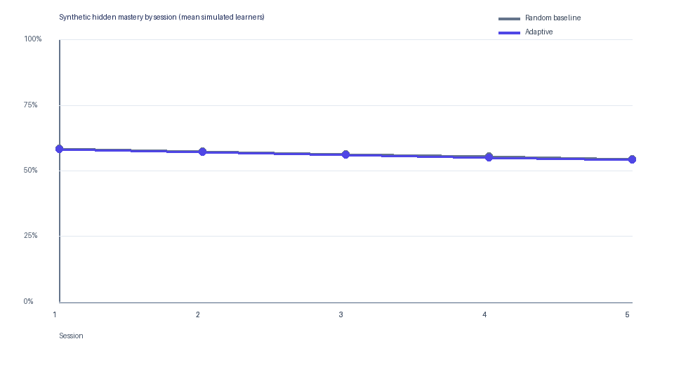

# Synthetic personalization simulation — Computer Network

Run date (UTC): 2026-10-14T13:01:45.560176+00:00
Course ID: `0016991c-2483-48f9-b9ed-02029a38f2bb`
Source excerpts read from the course: 161 across 9 topics
Protocol: 5 sessions × 1 questions × 4 profiles × 5 repeated runs
Seed: `17`

## Adaptive service path vs random baseline

| Arm | Synthetic hidden-mastery gain (mean ± SD) | Signed BKT bias (mean ± SD) | Mean absolute BKT error (mean ± SD) | Question repetition rate (mean ± SD) | Topic coverage (mean ± SD) | Recommendation weak-topic precision (mean ± SD) | Learners |
|---|---:|---:|---:|---:|---:|---:|---:|
| Random baseline | -0.0394 ± 0.0727 | -0.2420 ± 0.1338 | 0.2420 ± 0.1338 | 0.0000 ± 0.0000 | 0.3778 ± 0.0889 | 0.2015 ± 0.3580 | 20 |
| Adaptive | -0.0387 ± 0.0709 | -0.2215 ± 0.1327 | 0.2271 ± 0.1229 | 0.0000 ± 0.0000 | 0.3722 ± 0.1180 | 0.1618 ± 0.2823 | 20 |

### Reported metric definitions

Question repetition rate counts previously presented normalized question text for the same simulated learner. Topic coverage is the share of course topics practiced at least once. BKT error compares production mastery estimates with the simulator's hidden synthetic mastery; positive signed error means the estimate is higher. Recommendation weak-topic precision is the share of service-generated open recommendations (excluding diagnostic assess_topic items) aimed at topics whose synthetic hidden mastery is below 0.40; it is synthetic-only and unavailable when there were no eligible recommendations.

## Service evidence

Production path exercised in the disposable database: create_assessment → start_attempt → submit_attempt → grade_answer → record_answer → BKT update.
Created assessments: 200; submitted attempts: 200; graded answers: 200; BKT mastery events: 200.

## Method and limits

The runner reads indexed source excerpts and topic labels from the selected course. It copies those excerpts into an isolated in-memory SQLite database, where the app's real assessment creation and verification, attempt, grading, recommendation, and BKT update services run. No simulation rows are written to the configured user database. Simulated responses follow profile-specific hidden skill, slip, guess, learning, and forgetting parameters.

These are synthetic outcomes, not observations of students or evidence of real learning gains. BKT parameters remain fixed and are not fitted. Tutor conversation quality and recommendation relevance are not measured by this simulation.
